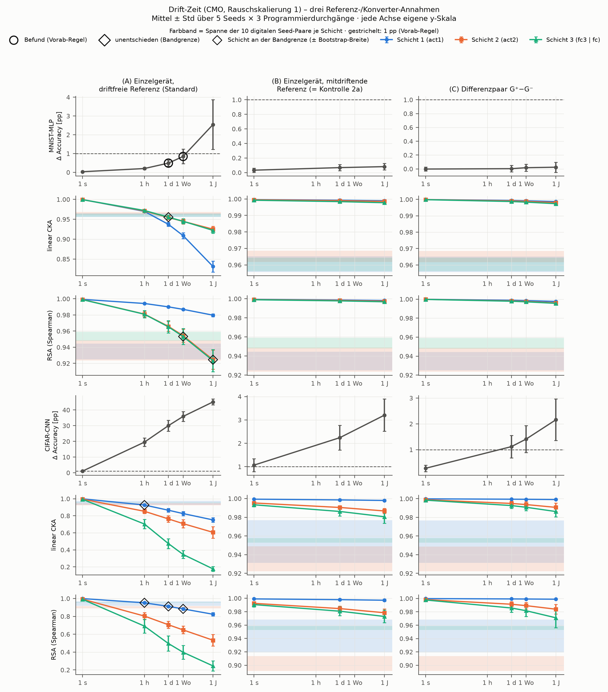
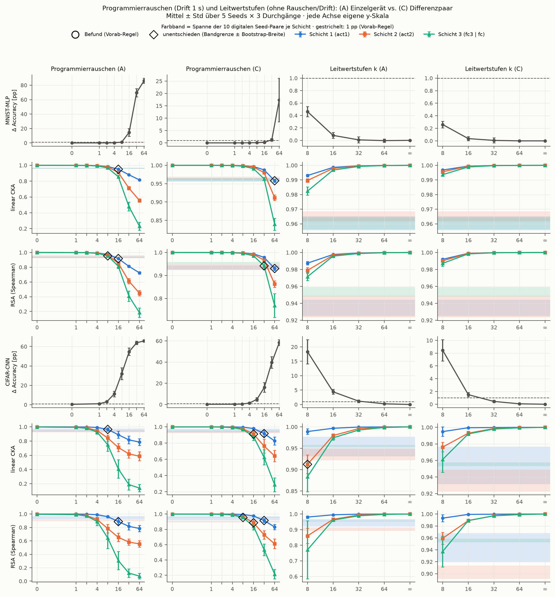
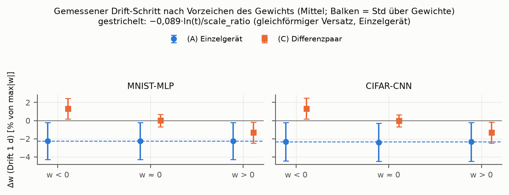

# Drift im ReRAM-Inferenzmodell: Konverter-Annahme, Accuracy und Repräsentationsgeometrie

*Stand 16.11.2026 · aihwkit 1.2.0 (= master @ 350ff34 in allen benutzten Modulen) · alle Zahlen aus `results/*.csv`, Fundstelle jeweils in eckigen Klammern*

## Kernaussage

Unter den untersuchten Einstellungen hängt der Drift-Schaden im `ReRamCMONoiseModel` überwiegend an der Konverter-Annahme. Mit Einzelgerät und driftfreier Referenz entsteht ein gleichförmiger Gewichtsversatz von etwa 2–2,5 % von max|w| nach 1 Tag [gate_drift_offset]. Er kostet auf CIFAR 30,0 pp Accuracy. Mit Differenzpaar sind es 1,1 pp, ohne Versatz (Kontrolle 2a) 2,2 pp [findings_all]. Die Geometrie-Befunde im MLP („nur CKA“) treten nur mit driftfreier Referenz auf. Die Geometrie-Analyse ist die zweite Ebene: Sie zeigt, dass linear CKA und RSA denselben Versatz unterschiedlich sehen.

**Offenlegung.** Die Variante (A) war vorab als Hauptlauf festgelegt und bleibt es. Die Frage nach dem Konverter kam erst nachträglich auf, durch eine Plausibilitätsprüfung (Gate) nach Abschluss aller Läufe. Die Varianten (B) und (C) sind deshalb Kontrollen und nicht vorab geplant. Die Vorab-Regel für Befunde wurde am 15.11.2026 vor dem CIFAR-Lauf festgelegt, nach Sicht der MNIST-Daten. Für MNIST gilt sie also nachträglich.

## Aufbau

- **Netze:** Ein MLP auf MNIST (784-256-256-10) mit 98,42 ± 0,09 % und ein CNN auf CIFAR-10 (2 Faltungen + 1 FC) mit 76,37 ± 0,45 % [baseline_summary]. Je Netz gibt es 5 Trainings-Seeds, digital trainiert, ohne hardware-bewusstes Training.
- **Analoge Inferenz:** aihwkit `InferenceRPUConfig` mit ideal angenommener Peripherie und `ReRamCMONoiseModel` (Annahmebereich 2 %, Drift-Kompensation aktiv). Je Seed und Einstellung gibt es 3 unabhängige Programmierdurchgänge, also 15 Werte, angegeben als Mittel ± Std.
- **Metriken:** Accuracy-Verlust auf dem vollen Testset, gemessen gegen das digitale Netz desselben Seeds. Linear CKA und RSA (Spearman auf 1 − Pearson-RDMs) gegen das digitale Netz, je Schicht auf 1000 festen Testbildern.
- **Referenzband:** Spanne [min, max] über alle 10 Paare digitaler Seeds.
- **Vorab-Regel:** Eine Einstellung ist ein *Befund*, wenn der Accuracy-Verlust ≤ 1 pp ist und CKA oder RSA in mindestens einer Schicht unter dem Band liegt.
- **Grenzfall-Regel (automatisiert):** Liegt ein Schichtmittel innerhalb ± der Breite des Bootstrap-Intervalls der Bandgrenze, gilt die Schicht als „unentschieden“ und nicht als außerhalb. Diese Breite wird nach unten gespiegelt, weil der Bootstrap eines Minimums nur nach oben streut. Eine accuracy-stabile Einstellung, deren Abweichung nur aus solchen Schichten besteht, heißt „unentschieden“ [findings_all, Spalte category].

**Drei Varianten des Drift-Modells:**

| Variante | Konverter | Referenz | Umsetzung |
|---|---|---|---|
| (A) | Einzelgerät | driftfrei | aihwkit-Standard. `SingleDeviceConductanceConverter` ist fest verdrahtet (reram.py:222). Die Rückrechnung `w = w_min + (g − g_min)/scale_ratio` (conductance.py:395) hat keine mitdriftende Null-Referenz. Die gemessene, leitwertunabhängige Relaxation `−0,089·ln t` µS (reram.py:306) wird so 1:1 zu einem gleichen Δw für alle Gewichte. |
| (B) | Einzelgerät | driftet mit | Kontrolle 2a: Mittelwert-Term der Drift auf 0 gesetzt, Streuung und Lese-Rauschen bleiben. |
| (C) | Differenzpaar G⁺ − G⁻ | – | `SinglePairConductanceConverter`, gleicher Leitwertbereich. Im eigenen Code nach der Konstruktion gesetzt, das Paket ist nicht gepatcht. |

**Warum (B) = 2a.** Driften alle Geräte und die Null-Referenz um dasselbe Δg, hebt sich Δg beim Abziehen der Referenz auf. Genau das ist 2a, mit einer Ausnahme: der Begrenzung auf [g_min, g_max]. Sie greift bei (A) auf andere Geräte als bei 2a.

Das ist exakt nachgeprüft. Beide Varianten verbrauchen dieselben Zufallszahlen. Die Gewichte von (A), korrigiert um Δg, und die von 2a unterscheiden sich nach 1 Tag bei 0,2 % (MNIST) bzw. 0,7 % (CIFAR) der Gewichte, nach 1 Jahr bei 3,4 % bzw. 5,8 %. Im Mittel beträgt der Unterschied ≤ 0,006 % von max|w| [check_b_equivalence]. Nicht modelliert ist in 2a das Eigenrauschen eines realen Referenzgeräts.

## Ergebnisse

**1. Der Versatz wirkt auf das Gewicht (Abb. 3).** Bei (A) ist der Drift-Schritt nach 1 Tag für positive, negative und ≈ 0-Gewichte gleich. Er beträgt −1,97 bis −2,53 % von max|w| je Kachel und entspricht der Vorhersage −0,089·ln(t)/scale_ratio auf < 2 % [gate_drift_offset]. Bei (C) schrumpft der Betrag symmetrisch (−1,33 % bei w > 0, +1,33 % bei w < 0, ≈ 0 bei w ≈ 0). Die skalare Drift-Kompensation gleicht das weitgehend aus (α = 1,04–1,19). Gegen den additiven Versatz bei (A) wirkt sie nicht (α = 0,94–1,00).

**2. Drift (Abb. 1, Tabelle).**
- **CIFAR, Variante (A):** Der Accuracy-Verlust steigt von 1,07 pp (1 s) auf 19,5 / 30,0 / 35,9 / 45,1 pp (1 h / 1 d / 1 Wo / 1 J). CKA und RSA fallen ab 1 h in allen Schichten unter das Band.
- **CIFAR, (B) und (C):** (B) verliert 2,2 / 3,2 pp (1 d / 1 J), (C) 1,1 / 1,4 / 2,2 pp (1 d / 1 Wo / 1 J). Die Geometrie bleibt in beiden Varianten in allen Schichten im Band.
- **CIFAR nach Vorab-Regel:** Es gibt keinen Befund, in keiner Variante. Accuracy-stabil sind nur Einstellungen ohne Drift (Rauschskala 0: 0,50 pp; ≥ 64 Stufen), und dort liegt die Geometrie im Band [findings_cifar10]. Schon der Ankerpunkt (A, Skala 1, 1 s) liegt mit 1,07 pp knapp über der Grenze. Dieser Nullbefund ist ein Ergebnis und kein fehlender Datenpunkt.
- **MNIST:** Unter (A) erfüllen drei Einstellungen die Vorab-Regel, alle „nur CKA“ [findings_mnist]. Werte: CKA, in Klammern die Bandgrenze; „unentsch.“ = innerhalb der Bootstrap-Breite.

| Einstellung | Accuracy-Verlust | CKA (Band-Min) |
|---|---|---|
| Drift 1 d | 0,49 pp | act1 0,937 (0,956), act2 0,954 (0,962) außerhalb; fc3 0,955 (0,956) unentsch. |
| Drift 1 Wo | 0,85 pp | act1 0,909, act2 0,945, fc3 0,945 außerhalb; RSA fc3 unentsch. |
| Default-Peripherie, 1 d | 0,67 pp | act1 0,935, act2 0,950, fc3 0,948 außerhalb |

  Bei fc3 nach 1 d liegt der Abstand zur Grenze (0,0009) innerhalb der Bootstrap-Breite (0,0055) [band_bootstrap_mnist]. Diese Schicht ist daher unentschieden, der Befund stützt sich auf act1 und act2. Neu „unentschieden“ sind die Anhang-Punkte Wan2022 nach 1 d und 2 d (0,93 / 0,92 pp; nur RSA fc3 an der Grenze). Unter (B) und (C) verschwinden alle drei Befunde: Der Verlust liegt bei ≤ 0,08 pp, CKA bei ≥ 0,997 [findings_all].

**3. CKA und RSA sehen den Versatz unterschiedlich.**
- **Beobachtung:** Unter (A) liegt RSA auf MNIST nicht unter dem Band. Mit 0,990 (act1, 1 d) liegt RSA sogar höher als das Band der Seed-Paare (0,925–0,944). CKA fällt dagegen heraus [sweep_summary_mnist].
- **Mechanismus vor der ReLU:** Ein gleichförmiges Δw addiert in jeder Einheit desselben Stimulus denselben Wert Δw·Σx. Der Pearson-Abstand der RDM zieht diesen Anteil pro Stimulus ab. Linear CKA zentriert dagegen nur über Stimuli je Einheit und behält ihn.
- **Nach der ReLU:** Auch die pro Stimulus zentrierte CKA (2b) bleibt auf MNIST außerhalb des Bands. Der Mechanismus erklärt also nur einen Teil.
- **Isoliert getestet** (digitale Eingabe, eine analoge Schicht):
  - Im MLP ist der Effekt vor der ReLU ein reiner Versatz pro Stimulus (zentrierte CKA ≥ 0,9996). Nur in Schicht 1 führt die ReLU ihn aus dem Band.
  - Im CNN ist der Effekt in den Faltungsschichten schon vor der ReLU kein reiner Versatz: conv2 isoliert 0,898 gegen Band-Min 0,914 nach 1 Wo [isolated_summary_*]. Ungeprüfte Vermutung: Der Versatz hängt bei der Faltung vom Ort ab (Rezeptivfeld, Zero-Padding).

**4. Rauschen und Stufen (Abb. 2, Variante A; (C) wird nachgetragen).**
- **Programmierrauschen, CIFAR:** Ab Skala 4 fällt der fc-Layer aus dem Band, bei 11,1 pp Verlust.
- **Programmierrauschen, MNIST:** Der Verlust bleibt bis Skala 4 unter 1 pp (0,24 pp). Bei Skala 8 sind es 1,13 pp, bei 16 dann 14,7 pp mit allen Schichten außerhalb. Bis Skala 8 liegt die Geometrie im Band.
- **Stufen, CIFAR:** 18,3 / 4,4 / 1,15 / 0,24 pp bei 8 / 16 / 32 / 64 Stufen. Nur bei 8 Stufen liegen act2 und fc außerhalb des Bands.
- **Stufen, MNIST:** Schon 8 Stufen kosten nur 0,46 pp, die Geometrie bleibt im Band [findings_*].
- **Befunde:** Accuracy und Geometrie verschlechtern sich in diesen Sweeps gemeinsam. Keine Einstellung ist ein Befund.

## Grenzen

- **Konverter-Annahme (Gate):** Der zentrale Effekt ist ein Modell-Artefakt im folgenden Sinn: Gemessen ist nur die leitwertunabhängige Relaxation der Einzelgeräte. Ob daraus in echter Hardware ein Gewichtsversatz wird, hängt von der Referenz- bzw. Differenzschaltung ab, und die ist nicht modelliert.
  - **Quelle:** Der Docstring nennt als Grundlage nur „Falcone et al. (In Review)“ (reram.py:172–173). Vermutlich ist das die inzwischen veröffentlichte Arbeit von Falcone et al., *All-in-One Analog AI Hardware …* (Adv. Funct. Mater. 2025, arXiv:2502.04524). Diese Zuordnung ist meine eigene, aihwkit nennt keinen Titel.
  - Die Arbeit beschreibt nur, dass „normalized weights are initially mapped into target conductances“ (Abschn. 2.2.1) bzw. jedes Gewicht in [−1, 1] „is mapped to its corresponding conductance value“ (Abschn. 4.6.1). Ob Einzelgerät oder Differenzpaar verwendet wurde und wie die Referenz realisiert war, steht dort nicht. **Diese Frage ist offen.**
  - Gemessen wurde die Relaxation laut Arbeit bis 1 Woche (Abschn. 2.2.2). Die Werte bei 1 Jahr sind also eine Extrapolation des ln t-Fits.
- **Hauptmodell:** Nur ein ReRAM-Rauschmodell. Wan2022 dient lediglich als Gegenprobe im Anhang [findings_all, Variante „Wan2022“].
- **Training:** Kein hardware-bewusstes Training. Die Netze sind klein (MLP, 2-Conv-CNN).
- **Referenzband:** Es stammt aus nur 10 Seed-Paaren (5 Seeds). Der Bootstrap über die Seeds gibt z. B. für act1/CKA (MNIST) ein beobachtetes Minimum von 0,9557, 95 %-Intervall [0,9557; 0,9631] [band_bootstrap_mnist]. Ein Bootstrap des Minimums zeigt nur Unsicherheit nach oben. Die Grenzfall-Regel spiegelt diese Breite nach unten; das ist eine Annahme und nicht aus den Daten abgeleitet.
- **Reproduzierbarkeit:** Der C++-Zufallsgenerator für Vorwärts- und Peripherie-Rauschen ist nicht seedbar. Der Punkt mit Default-Peripherie ist daher nicht bitgenau reproduzierbar, alle anderen Läufe (ideale Peripherie) schon.
- **Konverter-Override:** Variante (C) setzt den Konverter am fertigen Objekt. Ob die Fit-Koeffizienten aus Einzelgeräte-Messungen für ein Paar gelten, ist nicht belegt.
- **Rauschen und Stufen für (C):** Diese Läufe sind zum Zeitpunkt dieses Standes noch nicht abgeschlossen.

*Reproduktion: README bzw. `notes/step3_design.md`. Abbildungen: `python -m analog_geometry.report_figures`. Tabelle: `results/findings_all.csv`.*

**Abb. 1:** Drift-Zeit für die Varianten (A), (B) und (C), oben jeweils MNIST, unten CIFAR. Δ Accuracy mit 1-pp-Linie, darunter CKA und RSA je Schicht mit Seed-Band. Kreise markieren Befunde nach der Vorab-Regel, Rauten „unentschiedene“ Einstellungen (Accuracy-Zeile) bzw. Schichten an der Bandgrenze (Geometrie-Zeilen). Jede Achse hat ihre eigene y-Skala. Der 1-s-Punkt von (B) ist mit (A) identisch, weil ln 1 = 0.

**Abb. 2:** Programmierrauschen und Leitwertstufen, (A) und (C). Die Spalten für (C) werden automatisch gefüllt, sobald die CSVs vorliegen.

**Abb. 3:** Gemessener Drift-Schritt Δw nach 1 Tag, getrennt nach Vorzeichen des Gewichts, (A) gegen (C). Mittel über 5 Seeds und alle Kacheln.
