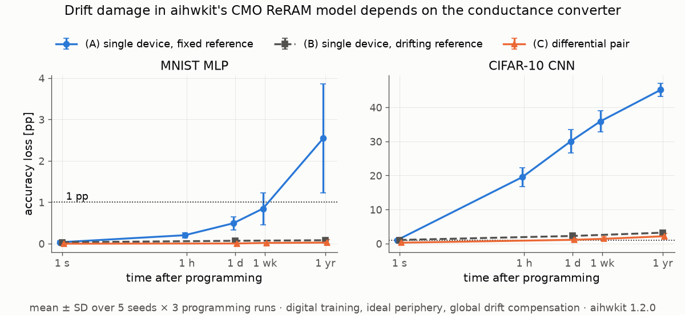

# Drift in aihwkit's CMO ReRAM inference model: the converter/reference assumption decides

Nils Leutenegger · independent researcher, Zug, Switzerland · nils.leutenegger@gmail.com · arXiv: 2608.12408, 2611.15533

*One-page summary · 16 Nov 2026 · aihwkit 1.2.0 · repository: [LINK-TO-REPO] · related aihwkit issue: [LINK-TO-ISSUE]*

**Question.** How do analog in-memory inference non-idealities (programming noise, finite conductance levels, drift) change the accuracy and the representational geometry (linear CKA, RSA) of small, digitally trained networks? While checking the drift results I found that the size of the drift effect depends mainly on which conductance converter the noise model assumes.

**Setup.**
- Networks: MLP 784-256-256-10 on MNIST (98.42 % test accuracy) and a 2-conv CNN on CIFAR-10 (76.37 %); 5 training seeds, digital training, no hardware-aware training.
- aihwkit `ReRamCMONoiseModel` (acceptance range 2 %), ideal periphery, global drift compensation; 3 programming runs per seed, so mean ± SD over 15 runs.
- Metrics: accuracy loss vs. the digital net of the same seed; linear CKA and RSA per layer vs. a reference band spanned by 10 pairs of digital seeds.
- Decision rule (fixed before the CIFAR runs, after the MNIST results; see report): a *finding* is a setting with ≤ 1 pp accuracy loss and CKA or RSA outside the band in at least one layer. Variants: (A) single device, fixed reference (aihwkit default); (B) single device, drifting reference; (C) differential pair.

**Key findings.**
1. **The drift damage is a converter effect.** With (A), the conductance-independent relaxation becomes a uniform weight offset of about 2–2.5 % of max|w| after 1 day, equal for positive, negative and near-zero weights. The per-tile scalar drift compensation cannot remove an additive offset (α = 0.94–1.00). On CIFAR this costs 30.0 pp after 1 day, versus 1.1 pp with a differential pair (C) and 2.2 pp with a drifting reference (B).
2. **Geometry findings in the MLP appear only with the fixed reference, and only under CKA.** Under (A), MNIST drift after 1 day (0.49 pp) and 1 week (0.85 pp) and the default-periphery point (0.67 pp) meet the rule; for example, CKA in layer 1 drops to 0.937 against a band minimum of 0.956. Under (B) and (C) all three disappear (loss ≤ 0.08 pp, CKA ≥ 0.997). On CIFAR the rule cannot be tested for (A) and (B), because the anchor point without drift offset already loses 1.07 pp; for (C) it can be tested and gives no finding.
3. **CKA and RSA see the offset differently.** Under (A), RSA on MNIST does not leave the band; at 0.990 (layer 1, 1 day) it is even above the seed-pair band (0.925–0.944), while CKA drops below it. Before the ReLU, a uniform Δw adds the same value to every unit for a given stimulus; the Pearson-based RDM removes this per-stimulus shift, linear CKA keeps it. This explains only part of the effect, since stimulus-centred CKA also stays outside the band.

**Limitations.**
- The offset is a modelling question: only device relaxation is measured, the reference or differential circuit is not modelled, and the source does not state whether a single device or a pair was used (open question to the maintainers).
- Relaxation was characterised up to 1 week; values at 1 year extrapolate the ln(t) fit.
- Small networks without hardware-aware training, one ReRAM model, and a reference band from only 10 seed pairs.
- The pair variant overrides the converter after construction; whether the fitted coefficients apply per device in a pair is not established.
